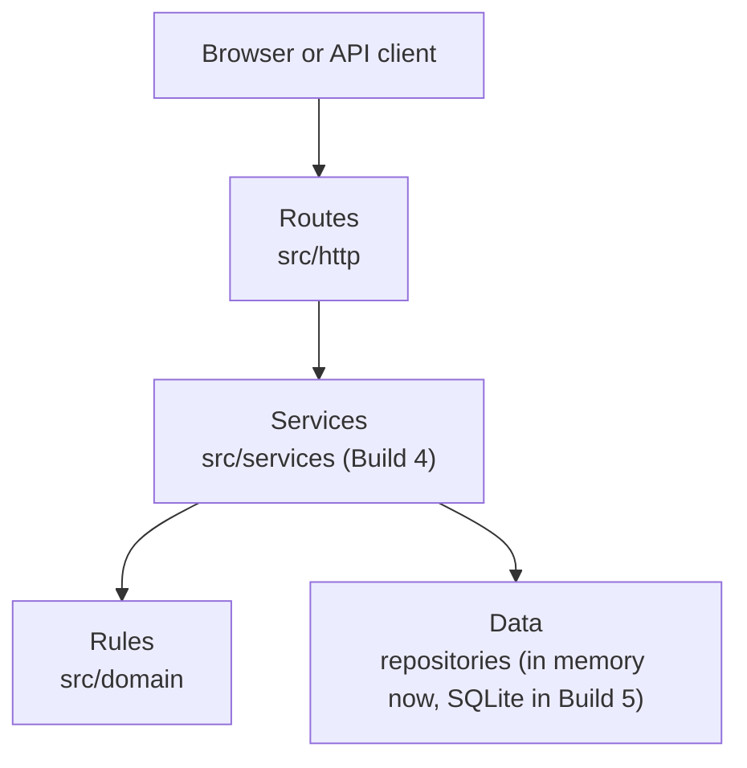
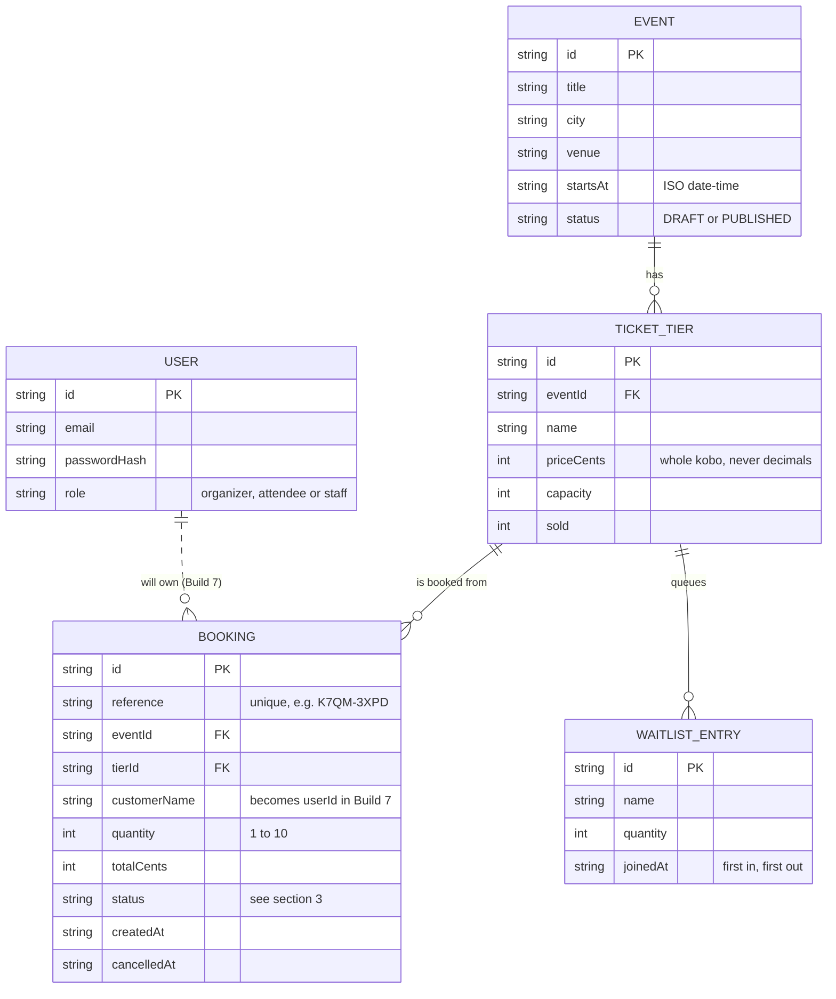
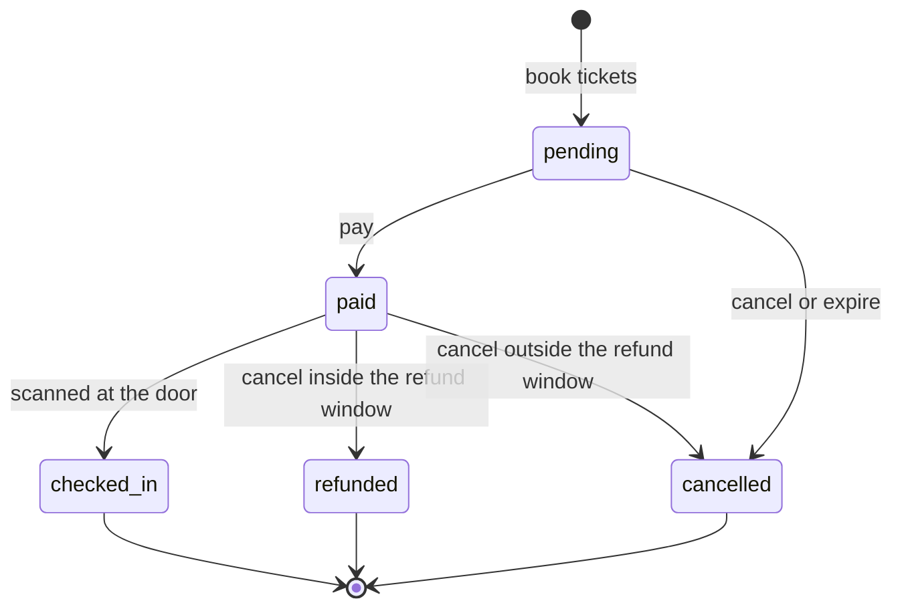

# Architecture

How the Event Ticketing platform is organised, what each layer may do, and how a booking moves through its life.

## 1. Layers

Calls only go downwards. Nothing in a lower layer imports from a higher one.

- **Routes** read the HTTP request, call one service, and turn the result or error into a JSON response; they never contain business rules and never touch data directly.
- **Services** run one use case from start to finish (for example "book tickets") by asking the rules what is allowed and the data layer to load and save; they know nothing about HTTP.
- **Rules** are pure functions and plain data (validation, search, the booking state machine) with no I/O, no HTTP and no clock or database access of their own.
- **Data** stores and loads records (a Map today, SQLite later) and contains no business decisions beyond keeping saved data consistent.

**Where we are today:** Build 3 adds the Routes layer (router and server) and the booking state machine in Rules. `src/domain/inventory.js` still holds both rules and the in-memory store. It is split into services and repositories in Build 4. Until then, it uses the state machine for every booking status change.

## 2. Data model

`USER` does not exist in code yet; it arrives in Build 7. Seats left in a tier are always `capacity - sold`, never stored.

## 3. Booking life cycle

### Every allowed move

| From | To | Meaning |
|---|---|---|
| pending | paid | Payment taken (S07) |
| pending | cancelled | Attendee cancels, or the unpaid booking expires (S10) |
| paid | checked_in | Staff scan the ticket (S14) |
| paid | refunded | Cancelled in time, money goes back (S09) |
| paid | cancelled | Cancelled too late, no money back (S09) |

`cancelled`, `refunded` and `checked_in` are **final**: nothing leaves them. Every other pair of states, including staying in the same state, is refused with `INVALID_TRANSITION`.

### Why final states matter

- **Seats are released exactly once.** A booking gives its seats back when it enters `cancelled` or `refunded`. Because neither can be left, the release cannot happen a second time.
- **No double payment or double refund.** `paid -> paid` and `refunded -> refunded` are not allowed moves.
- **No entry after cancelling.** A `cancelled` or `refunded` booking can never reach `checked_in`.
- `checked_in` keeps its seat, because the person is inside.

### Decisions recorded here

1. `cancelled` means "ended with no money back"; `refunded` means "ended with money back". There is no separate `expired` state: an expired unpaid booking is `pending -> cancelled`.
2. Which of `refunded` or `cancelled` a paid booking gets depends on the refund policy. That policy is built in Build 8; this build only makes both moves possible.
3. The state machine only answers "is this move allowed?". Seats, money and storage stay in the other layers.

## 4. The HTTP layer (Build 3)

### How one request travels

1. `src/server.js` starts the server on `PORT` (default 3000). It only starts things; it holds no logic.
2. `src/http/app.js` reads the request, asks the **router** which handler fits, reads the JSON body when the method has one, and runs the handler.
3. A handler returns `{ status, body }` or throws. It never writes to the response itself.
4. Whatever happens, the answer leaves through one function, so every success and every error has the same form.
5. If no route fits: a path under `/api` gets a JSON 404; any other `GET` or `HEAD` looks for a file in `public/`.

### One error shape

Every error, from every source, is `{"error":{"code":"...","message":"..."}}`. Details, stack traces and internal messages never reach the client; unexpected errors are logged on the server and the client sees a generic 500.

| Code | Status | Raised by |
|---|---|---|
| VALIDATION | 400 | domain |
| NOT_FOUND | 404 | domain, unknown route, missing file |
| SOLD_OUT | 409 | domain |
| CONFLICT | 409 | domain |
| INVALID_STATE | 409 | domain |
| INVALID_TRANSITION | 409 | domain (booking state machine) |
| BAD_REQUEST | 400 | HTTP (unreadable URL) |
| BAD_JSON | 400 | HTTP (body is not valid JSON) |
| METHOD_NOT_ALLOWED | 405 | HTTP (the path exists, the method does not; an `Allow` header lists the right ones) |
| PAYLOAD_TOO_LARGE | 413 | HTTP (body over 1 MB) |
| INTERNAL | 500 | anything unexpected |

The first six rows come from the table `DOMAIN_STATUS`, and the HTTP rows from the table `HTTP_STATUS`. Both live in `src/http/httpErrors.js`, the one file that defines every HTTP error: its code, status, wording and headers. The rest of the HTTP layer raises errors with small functions such as `badJson()` or `notFound()` and never writes a status number itself. A test fails if a domain code or an HTTP code is added without a status.

This file is separate from `src/domain/errors.js` on purpose: that one describes business problems (`SOLD_OUT`) and knows nothing about HTTP; this one describes web problems (`BAD_JSON`) and translates business problems into status numbers.

### Serving files safely

A file is served only if both checks pass:

1. **The names are safe.** The URL path is decoded once. A null byte, a backslash, a broken `%` escape, or any name that starts with `.` (`..`, `.env`, `.git`) is refused.
2. **The real location is inside `public/`.** The file's real path, with symbolic links followed, must still be inside the real `public/` folder.

Refused paths all get the same JSON 404, so an attacker learns nothing about what exists.
